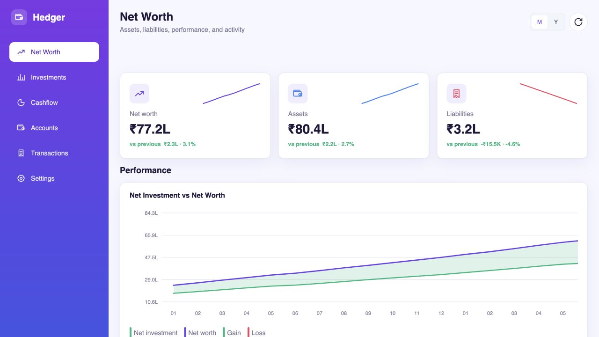
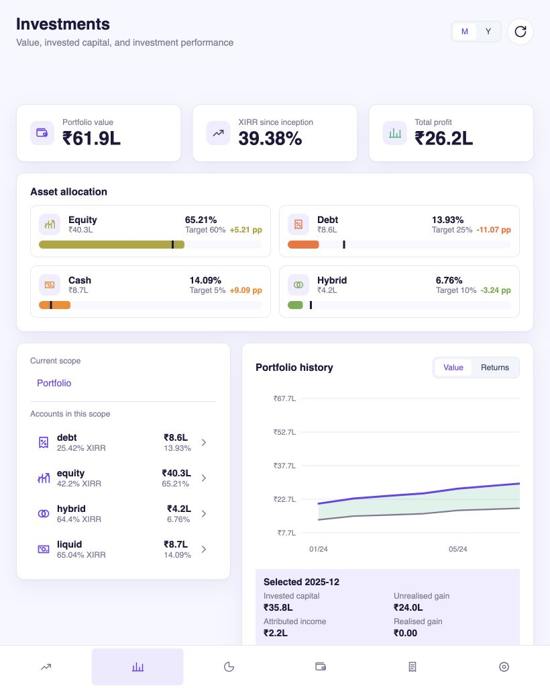
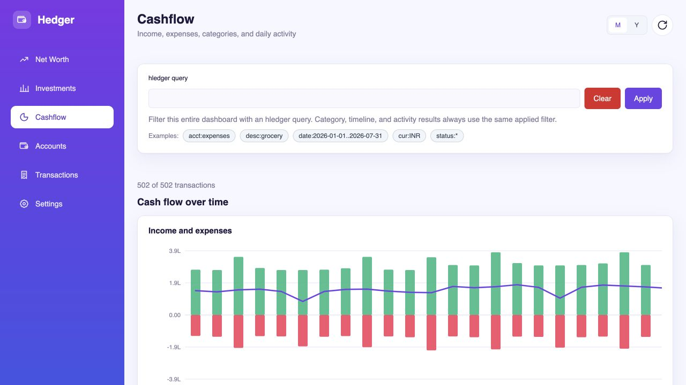
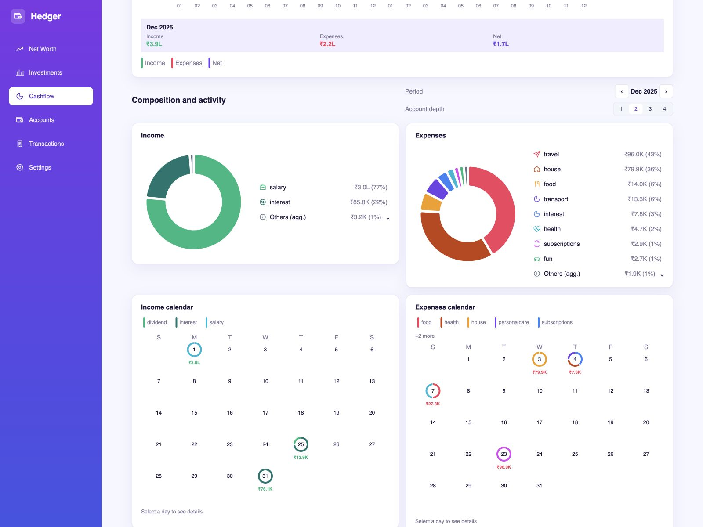
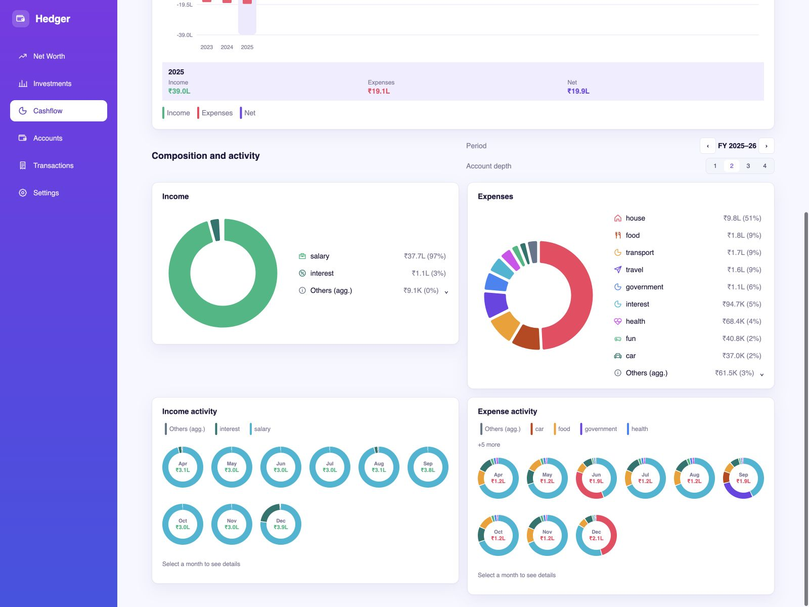
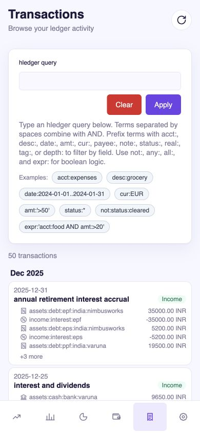

# Hedger

Hedger is a responsive, read-only personal finance dashboard for
[hledger](https://hledger.org/) journals.

## Features

### Net worth

Net worth, asset, and liability KPIs; monthly and yearly performance charts;
account composition; activity calendars; and transaction drill-down.



### Investments

Portfolio value, XIRR, total profit, target allocation, account drill-down,
value and return history, and realised/unrealised gain analysis.



### Cashflow

hledger query filtering, income/expense timelines, category composition, and
monthly or fiscal-year activity.







### Accounts and transactions

Expandable account trees, direct and subtree balances, account registers,
month-grouped transactions, complete postings, query filtering, and cursor
pagination.



Hedger is an installable PWA with desktop, tablet, and mobile layouts,
light/dark themes, automatic journal reloads, and live frontend refresh.

## Run the example

Start the backend with `hedger.example.yaml`:

```console
nix develop
just serve-backend
```

Start the frontend in another terminal:

```console
nix develop
just serve-frontend
```

Open <http://localhost:1234>. The example portfolio and all displayed data are
synthetic.

## Documentation

- [Configuration example](hedger.example.yaml)
- [Feature reference](docs/features.md)
- [Architecture](docs/architecture.md)
- [Backend](docs/backend.md)
- [Frontend](docs/frontend.md)
- [OpenAPI contract](contracts/openapi.json)
- [NixOS deployment](docs/nixos-deployment.md)
