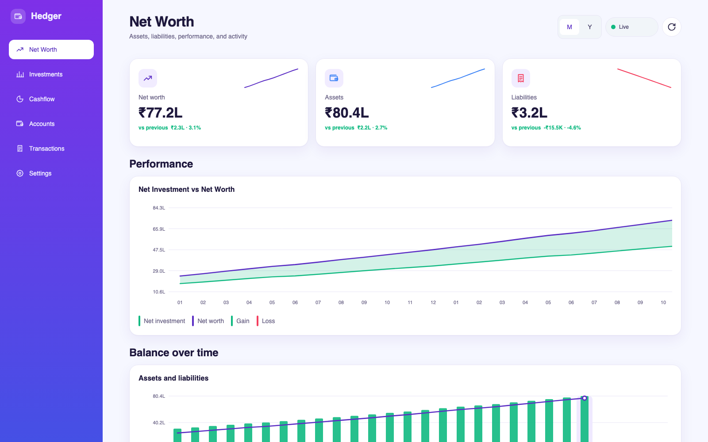
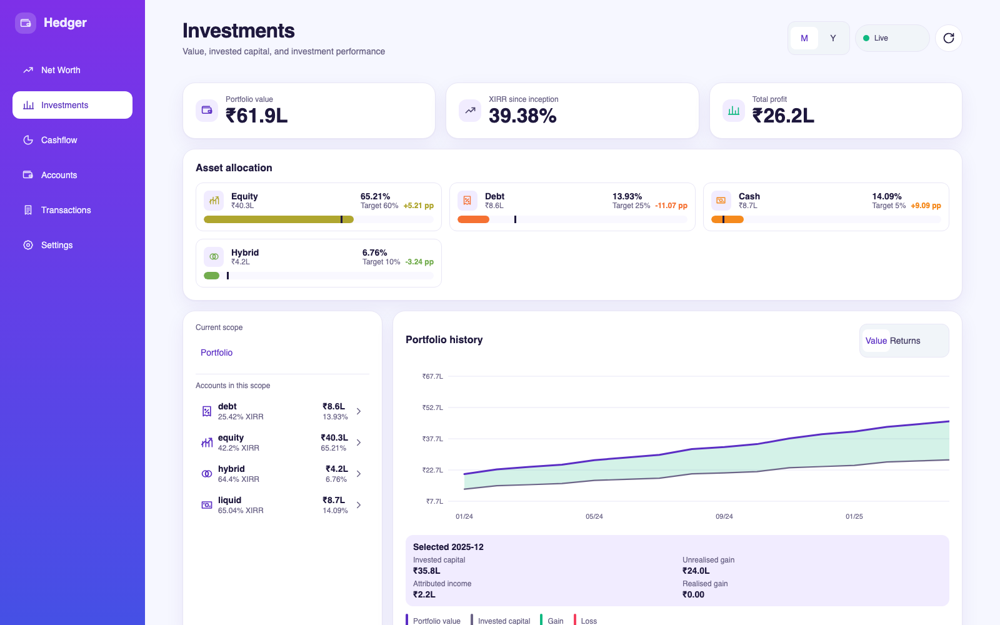
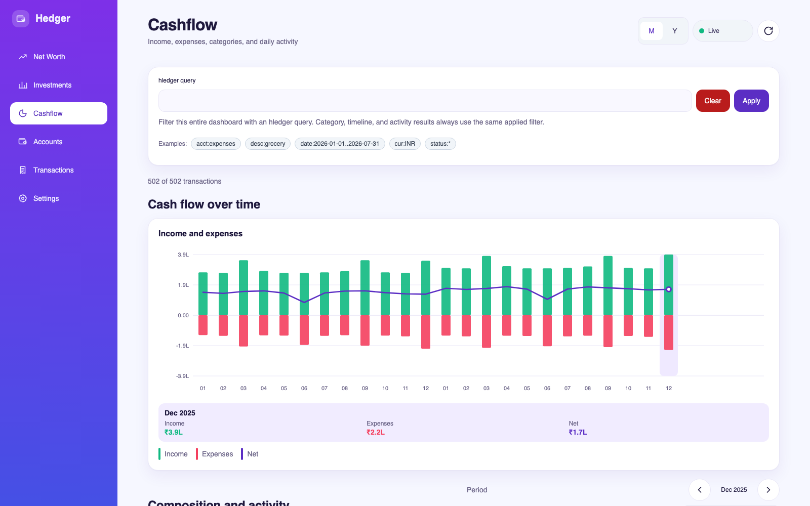
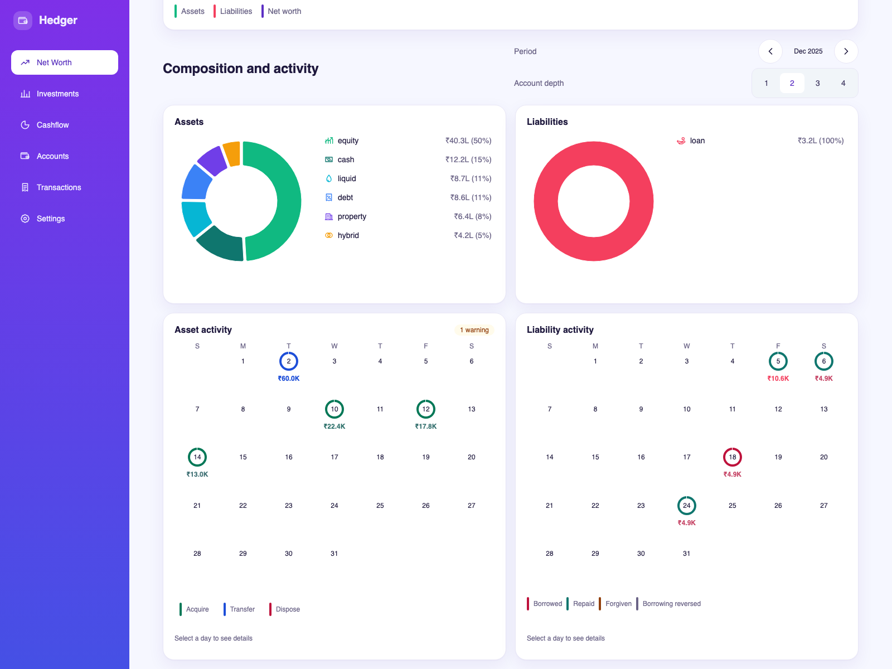
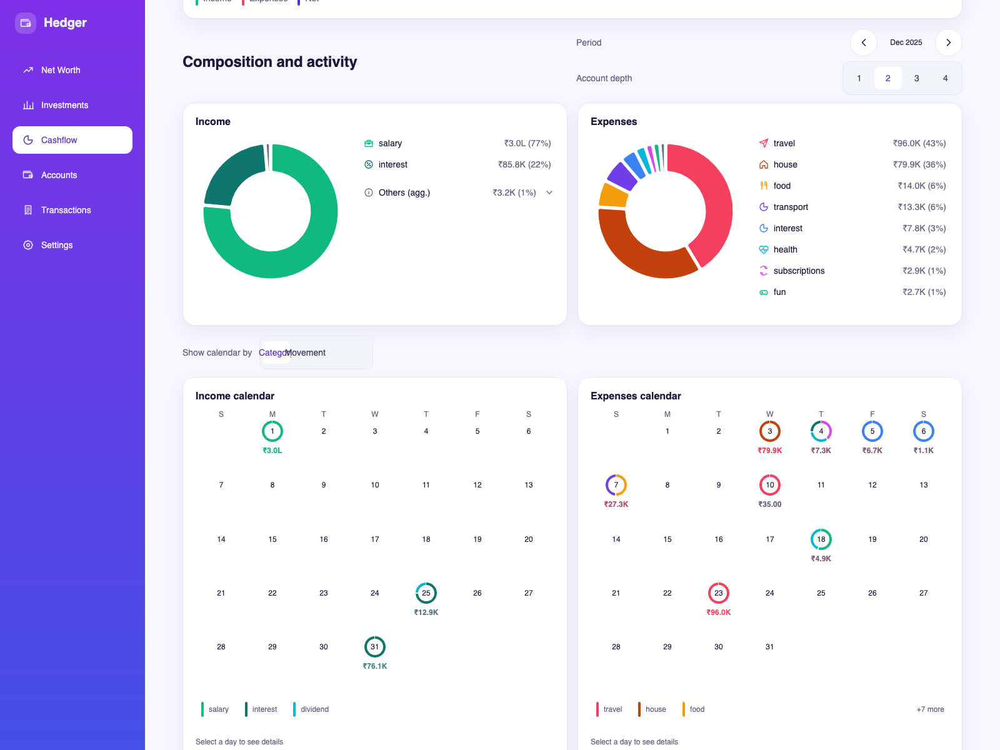
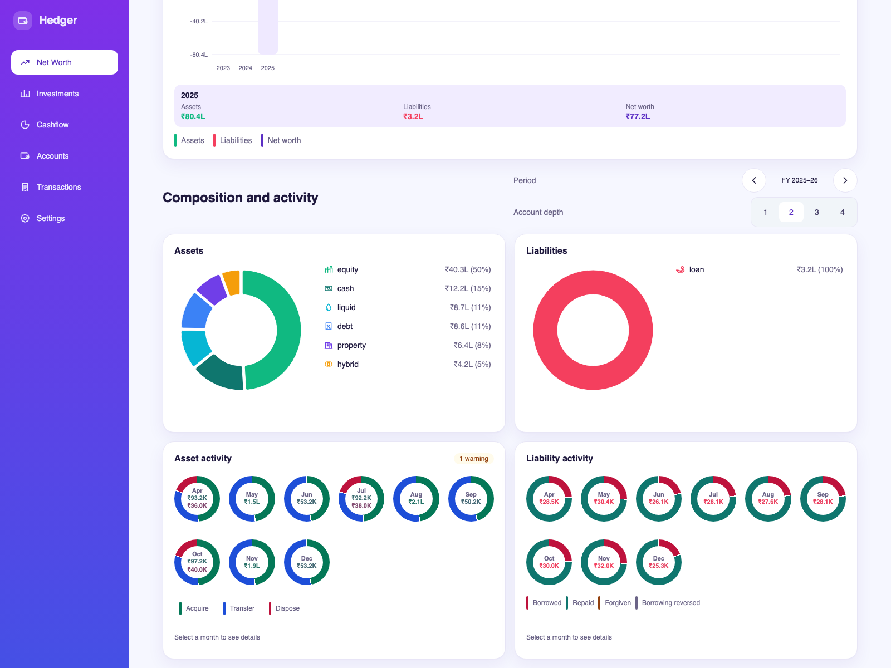
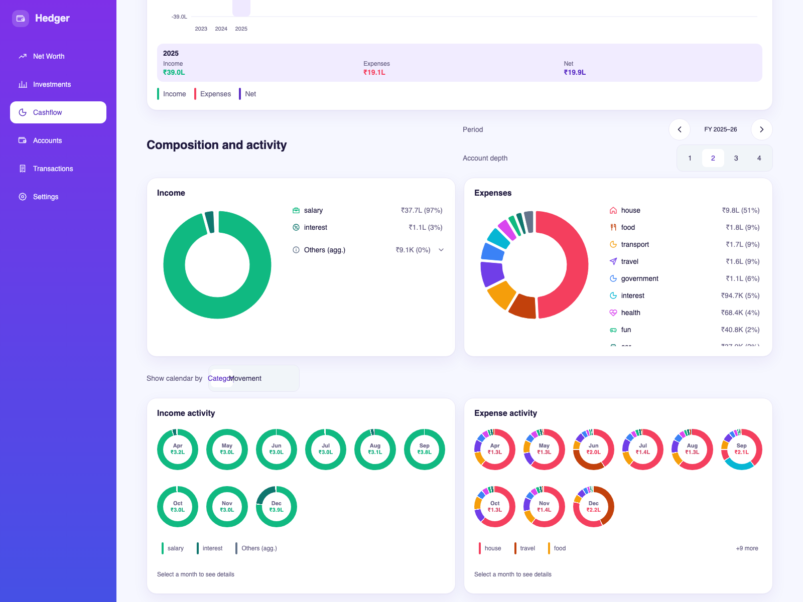
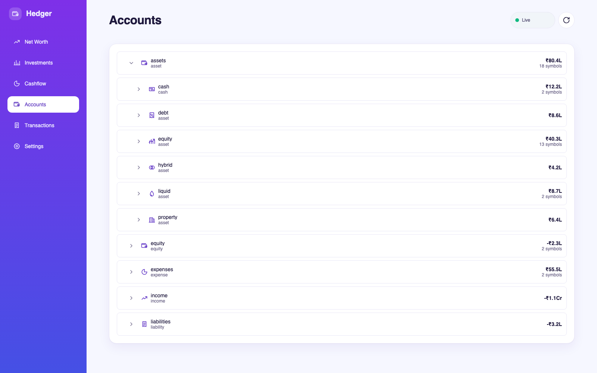
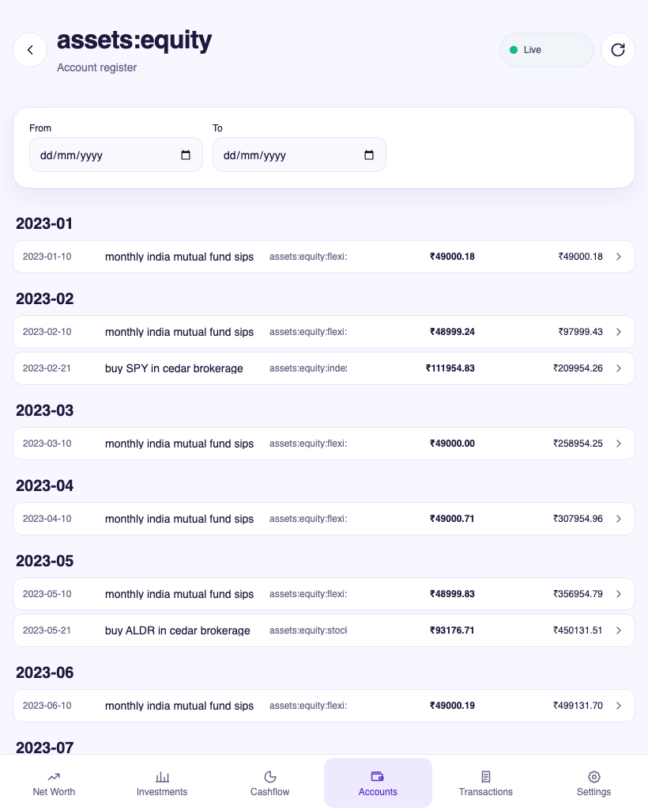
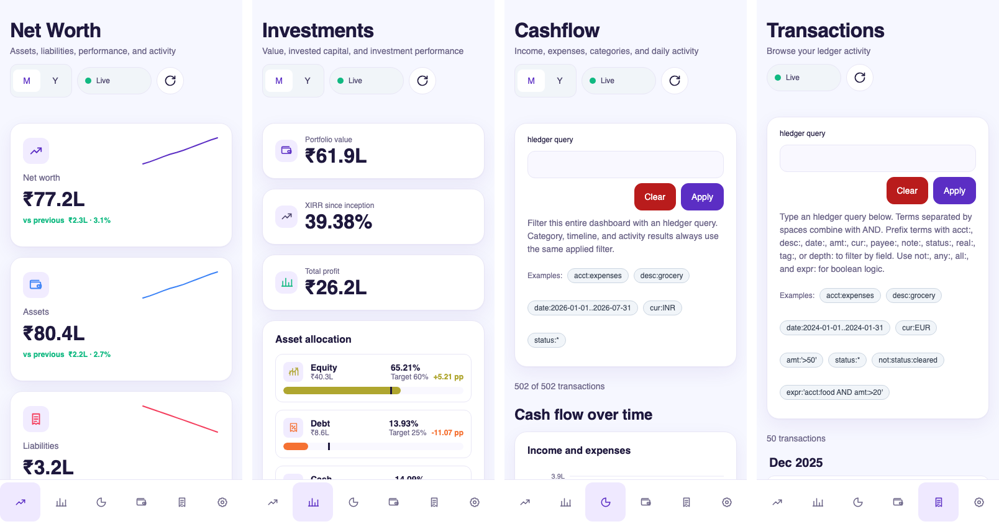

# Hedger

Hedger is a responsive, read-only personal finance dashboard for
[hledger](https://hledger.org/) journals. Point it at a journal and it displays
net worth, cashflow, investment performance, accounts, and transactions as a
fast, installable web app. It never writes to the ledger.

Built with Haskell ([Servant](https://hackage.haskell.org/package/servant) +
Warp + hledger-lib), an [Elm](https://elm-lang.org/) frontend, and Nix.

## Feature showcase

The screenshots use the bundled synthetic journal and switch between light and
dark with the page theme.

### Net worth

Net worth, asset, and liability KPIs with sparkline trends; monthly and yearly
performance charts; account composition; activity calendars; and transaction
drill-down.

<picture>
  <source media="(prefers-color-scheme: dark)" srcset="docs/images/readme/dark/net-worth-desktop.png">
  
</picture>

### Investments

Portfolio value, XIRR, total profit, target allocation, account drill-down,
value and return history, and realised/unrealised gain analysis.

<picture>
  <source media="(prefers-color-scheme: dark)" srcset="docs/images/readme/dark/investments-desktop.png">
  
</picture>

### Cashflow

hledger query filtering, income/expense timelines, category composition, and
monthly or fiscal-year activity.

<picture>
  <source media="(prefers-color-scheme: dark)" srcset="docs/images/readme/dark/cashflow-desktop.png">
  
</picture>

### Monthly and yearly analysis

The analysis section pairs composition donuts with activity calendars at two
scales: a single month and the configured fiscal year. Account depth controls
let you drill into the hierarchy.

<table>
  <thead>
    <tr>
      <th align="left">Period</th>
      <th align="center">Net worth</th>
      <th align="center">Cashflow</th>
    </tr>
  </thead>
  <tbody>
    <tr>
      <th align="left">Monthly December 2025</th>
      <td align="center">
        <a href="docs/images/readme/light/net-worth-monthly-analysis-desktop.png" title="Open full resolution">
          <picture>
            <source media="(prefers-color-scheme: dark)" srcset="docs/images/readme/dark/net-worth-monthly-analysis-desktop.png">
            
          </picture>
        </a>
      </td>
      <td align="center">
        <a href="docs/images/readme/light/cashflow-monthly-analysis-desktop.png" title="Open full resolution">
          <picture>
            <source media="(prefers-color-scheme: dark)" srcset="docs/images/readme/dark/cashflow-monthly-analysis-desktop.png">
            
          </picture>
        </a>
      </td>
    </tr>
    <tr>
      <th align="left">Fiscal year FY 2025–26</th>
      <td align="center">
        <a href="docs/images/readme/light/net-worth-yearly-analysis-desktop.png" title="Open full resolution">
          <picture>
            <source media="(prefers-color-scheme: dark)" srcset="docs/images/readme/dark/net-worth-yearly-analysis-desktop.png">
            
          </picture>
        </a>
      </td>
      <td align="center">
        <a href="docs/images/readme/light/cashflow-yearly-analysis-desktop.png" title="Open full resolution">
          <picture>
            <source media="(prefers-color-scheme: dark)" srcset="docs/images/readme/dark/cashflow-yearly-analysis-desktop.png">
            
          </picture>
        </a>
      </td>
    </tr>
  </tbody>
</table>

### Accounts and transactions

Expandable account trees, direct and subtree balances, account registers,
month-grouped transactions, complete postings, query filtering, and cursor
pagination.

<picture>
  <source media="(prefers-color-scheme: dark)" srcset="docs/images/readme/dark/accounts-desktop.png">
  
</picture>

Account registers stay usable on tablet:

<picture>
  <source media="(prefers-color-scheme: dark)" srcset="docs/images/readme/dark/account-register-tablet.png">
  
</picture>

### Responsive layouts

The same app switches to bottom navigation and single-column cards on phones.

  <a href="docs/images/readme/light/phone-views.png" title="Open full resolution">
    <picture>
      <source media="(prefers-color-scheme: dark)" srcset="docs/images/readme/dark/phone-views.png">
      
    </picture>
  </a>

Hedger is an installable PWA with desktop, tablet, and mobile layouts,
light/dark themes, automatic journal reloads, and live frontend refresh.

## Documentation

- [Features](docs/features.md) — what Hedger does, as user stories, plus the roadmap.
- [Architecture](docs/architecture.md) — how the system fits together.
- [Backend](docs/backend.md) — Haskell service, configuration, and HTTP API.
- [Frontend](docs/frontend.md) — Elm app structure, pages, and design system.
- [Performance](docs/performance.md) — benchmarking methodology, results, and lessons.
- [Deployment](docs/deployment.md) — the NixOS module and production topology.
- [Local development](docs/local-development.md) — dev shell, running, and checks.

The [configuration example](hedger.example.yaml) shows every supported option.

Agent and contributor instructions live in [AGENTS.md](AGENTS.md).

## License

Hedger is free software, licensed under the
[GNU Affero General Public License v3.0 or later](LICENSE)
(AGPL-3.0-or-later).
